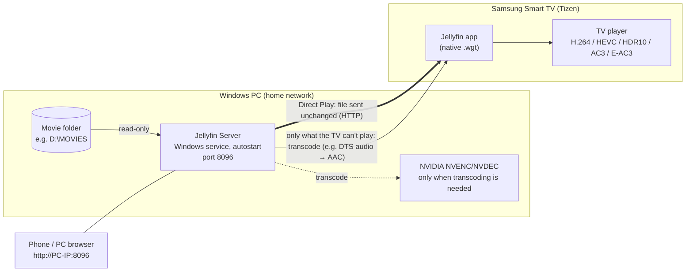
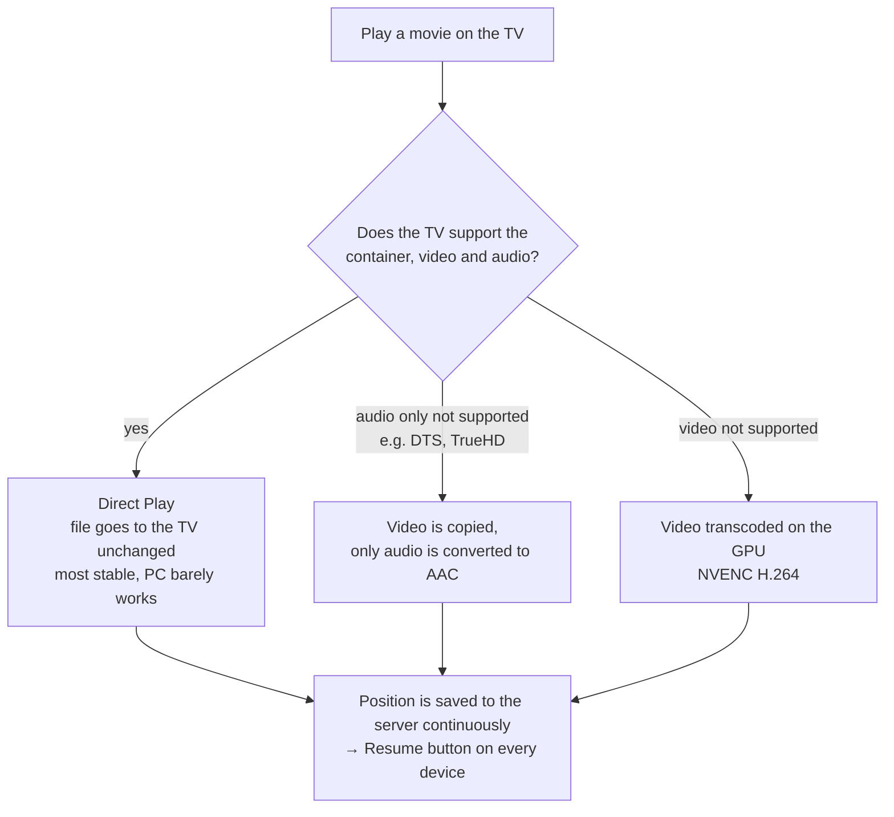
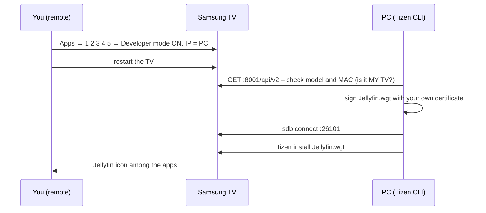

# Jellyfin: home movies on a Samsung Smart TV (Tizen)

🇨🇿 [Česká verze](README.md)

Stream your home movie collection from a Windows PC to a Samsung TV using the **official Jellyfin Server** and the
**native Jellyfin app on the TV**. No custom server and no playback in the TV's web browser. The main goal is
**stable playback**: Direct Play, reliable seeking, and resuming where you left off.

Tested on a Samsung **UE70RU7092** (2019, Tizen 5.0) with Jellyfin **12.4**. The server runs on Windows 11 with an
NVIDIA RTX graphics card.

> This repository contains only the concept, scripts and guide. It contains no movies, passwords, certificates,
> installers or addresses of any real network.

---

## How it works



**What happens when you press Play:**



**How the app gets onto the TV:**



### Why sideload instead of the Samsung store

The Jellyfin app in the Samsung Apps store is available only for TVs from **2021 and newer** (Tizen 6+). Older
models (2017–2020) won't find it in the store. The same official app
([jellyfin/jellyfin-tizen](https://github.com/jellyfin/jellyfin-tizen)) can be installed from a PC in Developer
mode. Ready-made builds are available from
[jeppevinkel/jellyfin-tizen-builds](https://github.com/jeppevinkel/jellyfin-tizen-builds).

**The app version on the TV must match the server version.** When you update the server, install the new app
too. The procedure is the same and uses the same certificate.

---

## Requirements

| What | Where |
|---|---|
| Windows 10/11 PC on the home network (ideally wired, with a static IP or DHCP reservation) | – |
| Jellyfin Server for Windows | https://jellyfin.org/downloads/windows |
| Samsung Tizen Studio **CLI** (web-cli, no IDE) | https://developer.tizen.org/development/tizen-studio/download |
| Jellyfin.wgt **matching the server version** | https://github.com/jeppevinkel/jellyfin-tizen-builds/releases |
| Optional: NVIDIA GPU (video transcoding) | – |
| Python 3 (only for `tv_info.py`) | https://www.python.org |

> The scripts print their messages in Czech. The parameters and logic are described below.

---

## Installation, step by step

### 1. Server on the PC

1. Download the Jellyfin Server installer for Windows and verify its SHA256.
2. In an **elevated** PowerShell, run:
   ```powershell
   .\scripts\1_install_server.ps1 -Installer C:\Downloads\jellyfin_12.4_windows-x64.exe
   ```
   The script installs Jellyfin as a service that **starts with Windows** and **restarts on failure**. It opens
   ports 8096/TCP and 7359/UDP in the firewall, but **only for the Private network profile and the local
   subnet**.
3. Check that the PC's network profile is **Private**:
   ```powershell
   Get-NetConnectionProfile
   ```

### 2. Movie library

1. **Before** finishing the setup wizard, run:
   ```powershell
   .\scripts\2_setup_library.ps1 -MediaPath 'D:\MOVIES' -ServerName 'MOVIES'
   ```
   The script sets the language to Czech and creates a read-only **Filmy** (Movies) library. Nothing is written
   into the movie folders; metadata and thumbnails are kept in `C:\ProgramData\Jellyfin\Server`. Edit `cs` and
   `CZ` in the script for a different language or country.
2. Open `http://localhost:8096` and go through the wizard. Create the admin account yourself and remember the
   password. **Click through to the very last "Finish"** (see [Troubleshooting](#troubleshooting)).

### 3. GPU transcoding (NVIDIA)

Encoding settings can only be changed after signing in, so use the web UI:
**Dashboard → Playback → Transcoding**

- Hardware acceleration: **Nvidia NVENC**
- Decoding: tick H.264, HEVC, MPEG2, VC1, VP8, VP9, AV1, HEVC 10bit and VP9 10bit
- Encoding: **H.264**. *Disable HEVC and AV1 encoding*, because H.264 is the safest choice for older TVs.
- Tone mapping: enable it (HDR → SDR when needed)

The goal, though, is that transcoding is almost never needed (Direct Play).

### 4. The app on the TV

1. Install **Tizen Studio CLI**, for example into `C:\tizen-studio`. Silent install:
   ```powershell
   web-cli_Tizen_Studio_6.1_windows-64.exe --accept-license C:\tizen-studio
   ```
   The installer may hang after copying the files. Once `tools\sdb.exe` exists, it's done.
2. Download a `Jellyfin.wgt` **matching the server version**.
3. **Enable Developer mode on the TV:**
   1. Open **Apps**.
   2. Press **1 2 3 4 5** on the remote.
   3. Set **Developer mode → On** and enter your PC's IP as **Host PC IP**.
   4. **Restart the TV**, ideally by unplugging it for 10 seconds.
4. Make sure the IP really belongs to your TV:
   ```powershell
   python scripts\tv_info.py 192.168.1.20
   ```
   Write down `modelName` and `wifiMac`.
5. Install the app:
   ```powershell
   .\scripts\3_install_tv.ps1 -TvIp 192.168.1.20 -ExpectedModel UE70RU7092UXXH -ExpectedMac aa:bb:cc:dd:ee:ff `
                              -Wgt C:\Downloads\Jellyfin.wgt -TizenRoot C:\tizen-studio
   ```
   The script **first verifies the model and MAC**, so the app is never installed on a neighbour's TV on the same
   network. On the first run it creates a signing certificate and stores its password outside the repository. It
   then signs a copy of the package, connects to the TV, and installs and launches the app.

### 5. First launch on the TV

1. The Jellyfin app often doesn't find the server by itself. If so, choose **Add server** and enter
   `PC-IP:8096`, for example `192.168.1.10:8096`.
2. Sign in. The easier way is **Quick Connect**: the TV shows a code and you approve it on a PC or phone where you
   are already signed in (user icon → Quick Connect). You don't have to type the password with the remote.

---

## What a 2019 TV (Tizen 5) plays directly

| | Direct Play | Note |
|---|---|---|
| MP4 / MKV, H.264 | ✅ | |
| MKV, HEVC (incl. 10bit), 4K, HDR10 | ✅ | |
| Dolby Vision | ⚠️ | not supported by the TV; profile 8 plays as HDR10, profile 5 is transcoded |
| AVI, MPEG-4 ASP (XviD/DivX) | ✅/⚠️ | older rips, usually fine |
| AAC, AC3, E-AC3 (DD+) audio | ✅ | |
| **DTS**, TrueHD audio | ❌ | the server converts **audio only** to AAC; video is passed through unchanged |

To see how a movie is actually played, open **Dashboard → Activity / Sessions**. It shows Direct Play or
Transcode, including the reason.

---

## Troubleshooting

| Symptom | Cause / fix |
|---|---|
| TV says "no servers found" | Auto-discovery (UDP 7359) often doesn't work on Tizen. Enter the server manually: `PC-IP:8096`. |
| TV shows the setup wizard instead of the login | The server's wizard was never finished (`IsStartupWizardCompleted=false` in `system.xml`). Finish it in a browser all the way to "Finish", or run on the PC: `Invoke-WebRequest http://localhost:8096/Startup/Complete -Method Post`. The wizard on the TV will not change the password of an existing account. |
| Forgotten password | On the PC login page choose **Forgot password** and enter the user. A PIN is saved to `C:\ProgramData\Jellyfin\Server\passwordreset*.json`. After you enter it on the PIN page, **the password becomes that PIN** (e.g. `AB-12-CD-34`). Sign in with it and change it in your Profile. |
| `tv_info.py` reports `developerMode: 0` | Some models report 0 even when the mode is on. What counts is whether `sdb connect IP:26101` succeeds. |
| `sdb connect` fails | Developer mode is set with a different IP, the TV wasn't restarted after enabling it, or the PC and TV are on different networks. |
| The TV app shows an error after a server update | The app and server versions differ. Download a new `.wgt` of the same version and repeat step 4.5. |
| API calls return 401 | Since version 12, `?api_key=` in the URL no longer works. Use the header `Authorization: MediaBrowser Client="x", Device="x", DeviceId="x", Version="1", Token="…"`. |

---

## Security

- The server is reachable **only from the home network**: the firewall allows only the Private profile and the
  local subnet. No port is opened to the internet.
- Never commit `*.p12` files, passwords, `*.wgt` files, installers or movies. The `.gitignore` guards against
  this.
- Each household member should have their own account (Dashboard → Users), with their own history and
  "Continue watching".
- Developer mode on the TV can stay on. It allows installs only from one IP address, the one of your PC.

## License and credits

The scripts in this repository are free to use. Jellyfin is licensed under GPL-2.0 and is a project of
[jellyfin.org](https://jellyfin.org). The Tizen packages are built by
[jeppevinkel/jellyfin-tizen-builds](https://github.com/jeppevinkel/jellyfin-tizen-builds).
