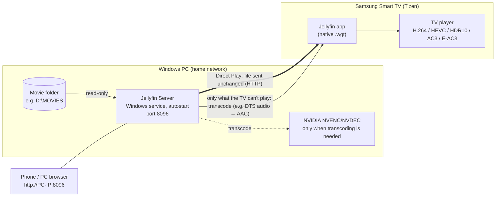
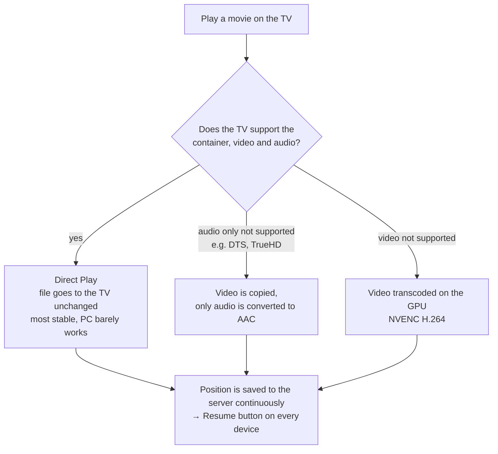
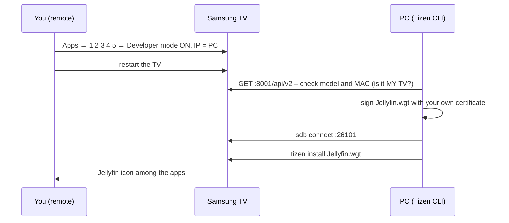
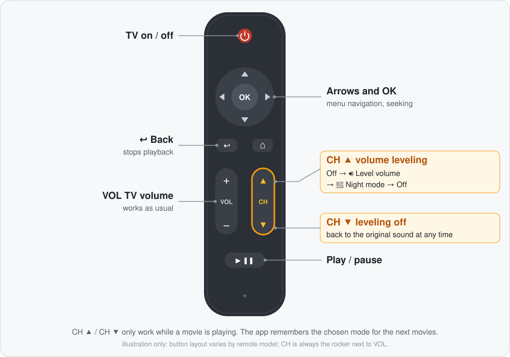
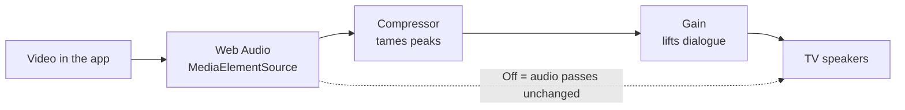

# Jellyfin: home movies on a Samsung Smart TV (Tizen)

🇨🇿 [Česká verze](README.md)

Stream your home movie collection from a Windows PC to a Samsung TV using the **official Jellyfin Server** and the
**native Jellyfin app on the TV**. No custom server and no playback in the TV's web browser. The main goal is
**stable playback**: Direct Play, reliable seeking, and resuming where you left off.

Tested on a Samsung **UE70RU7092** (2019, Tizen 5.0) with Jellyfin **12.4**. The server runs on Windows 11 with an
NVIDIA RTX graphics card.

> This repository contains only the concept, scripts and guide. It contains no movies, passwords, certificates,
> installers or addresses of any real network.

## Which TVs is this for

**Samsung TVs running Tizen**, mainly **2017–2020** models, for which Jellyfin is not available in the app store.
The year is encoded by a letter in the model name, e.g. UE70**R**U7092 = 2019 (in the US the prefix is UN instead
of UE).

| Year | Model letter | Tizen | Jellyfin in the Samsung store | This guide (install from PC) | Volume leveling |
|---|---|---|---|---|---|
| 2017 | M (e.g. UE55**M**U6172) | 3.0 | ❌ | ⚠️ not tested | ⚠️ probably not |
| 2018 | N (e.g. UE55**N**U7172) | 4.0 | ❌ | ⚠️ should work | ⚠️ probably not |
| **2019** | **R** (e.g. UE70**R**U7092) | **5.0** | ❌ | ✅ **tested** | ❌ **does not work** |
| 2020 | T (e.g. UE55**T**U7172) | 5.5 | ❌ | ⚠️ should work | ⚠️ probably not |
| 2021 and newer | A, B, C, D… | 6.0+ | ✅ the store is enough | not needed | ⚠️ probably not |

- Tested on a **UE70RU7092** (2019, Tizen 5.0) with Jellyfin 12.4. For other models, check the list of tested TVs
  in [jellyfin-tizen-builds/COMPATIBILITY.md](https://github.com/jeppevinkel/jellyfin-tizen-builds/blob/HEAD/COMPATIBILITY.md).
- On **2021 and newer** TVs the store app is enough.
- **In-app volume leveling (step 6) does not work on the tested TV** – see the note in step 6. Use the TV's built-in
  **Auto Volume** instead.
- Samsung TVs **from 2016 and older** (Tizen 2.x, or the even older Orsay) have too old a browser; current Jellyfin
  will most likely not run there. **Not for other brands either**: LG (webOS) and Android TV / Google TV have their
  own Jellyfin app.
- Developer mode, used for the install, is available on every Samsung Tizen TV. No Samsung account or payment
  needed.

---

## How it works



**What happens when you press Play:**



**How the app gets onto the TV:**



### Why sideload instead of the Samsung store

The Jellyfin app in the Samsung Apps store is available only for TVs from **2021 and newer** (Tizen 6+). Older
models (2017–2020) won't find it in the store. The same official app
([jellyfin/jellyfin-tizen](https://github.com/jellyfin/jellyfin-tizen)) can be installed from a PC in Developer
mode. Ready-made builds are available from
[jeppevinkel/jellyfin-tizen-builds](https://github.com/jeppevinkel/jellyfin-tizen-builds).

**The app version on the TV must match the server version.** When you update the server, install the new app
too. The procedure is the same and uses the same certificate.

---

## Requirements

| What | Where |
|---|---|
| Windows 10/11 PC on the home network (ideally wired, with a static IP or DHCP reservation) | – |
| Jellyfin Server for Windows | https://jellyfin.org/downloads/windows |
| Samsung Tizen Studio **CLI** (web-cli, no IDE) | https://developer.tizen.org/development/tizen-studio/download |
| Jellyfin.wgt **matching the server version** | https://github.com/jeppevinkel/jellyfin-tizen-builds/releases |
| Optional: NVIDIA GPU (video transcoding) | – |
| Python 3 (only for `tv_info.py`) | https://www.python.org |

> The scripts print their messages in Czech. The parameters and logic are described below.

---

## Installation, step by step

### 1. Server on the PC

1. Download the Jellyfin Server installer for Windows and verify its SHA256.
2. In an **elevated** PowerShell, run:
   ```powershell
   .\scripts\1_install_server.ps1 -Installer C:\Downloads\jellyfin_12.4_windows-x64.exe
   ```
   The script installs Jellyfin as a service that **starts with Windows** and **restarts on failure**. It opens
   ports 8096/TCP and 7359/UDP in the firewall, but **only for the Private network profile and the local
   subnet**.
3. Check that the PC's network profile is **Private**:
   ```powershell
   Get-NetConnectionProfile
   ```

### 2. Movie library

1. **Before** finishing the setup wizard, run:
   ```powershell
   .\scripts\2_setup_library.ps1 -MediaPath 'D:\MOVIES' -ServerName 'MOVIES'
   ```
   The script sets the language to Czech and creates a read-only **Filmy** (Movies) library. Nothing is written
   into the movie folders; metadata and thumbnails are kept in `C:\ProgramData\Jellyfin\Server`. Edit `cs` and
   `CZ` in the script for a different language or country.
2. Open `http://localhost:8096` and go through the wizard. Create the admin account yourself and remember the
   password. **Click through to the very last "Finish"** (see [Troubleshooting](#troubleshooting)).

#### Several libraries (e.g. movies by language)

Each library is a separate tile in the TV app. Use it to keep, say, Czech-dubbed and Ukrainian-dubbed movies apart,
or kids' movies, or TV shows. The rule is simple: **one subfolder = one library**.

```
D:\MOVIES\
├── CZ\   → library "Filmy"
└── UA\   → library "UA filmy"
```

- **During the initial setup** (before finishing the wizard) the script does it for you:
  ```powershell
  .\scripts\2_setup_library.ps1 -ServerName 'MOVIES' -Libraries @{ 'Filmy' = 'D:\MOVIES\CZ'; 'UA filmy' = 'D:\MOVIES\UA' }
  ```
- **Later**, in the web UI: **Dashboard → Libraries → Add Media Library**, content type *Movies*, folder
  `D:\MOVIES\UA`. Then edit the original library: remove the root `D:\MOVIES` and add `D:\MOVIES\CZ`, otherwise
  the UA movies would show up in both libraries.
- No movie may stay directly in the root `D:\MOVIES`, or it disappears from the app. Move it into a subfolder.
- Jellyfin identifies a movie by its file path. Moving files or changing library folders can lose the "Continue
  watching" position, so it is best to split the folders right at the start.

### 3. GPU transcoding (NVIDIA)

Encoding settings can only be changed after signing in, so use the web UI:
**Dashboard → Playback → Transcoding**

- Hardware acceleration: **Nvidia NVENC**
- Decoding: tick H.264, HEVC, MPEG2, VC1, VP8, VP9, AV1, HEVC 10bit and VP9 10bit
- Encoding: **H.264**. *Disable HEVC and AV1 encoding*, because H.264 is the safest choice for older TVs.
- Tone mapping: enable it (HDR → SDR when needed)

The goal, though, is that transcoding is almost never needed (Direct Play).

### 4. The app on the TV

1. Install **Tizen Studio CLI**, for example into `C:\tizen-studio`. Silent install:
   ```powershell
   web-cli_Tizen_Studio_6.1_windows-64.exe --accept-license C:\tizen-studio
   ```
   The installer may hang after copying the files. Once `tools\sdb.exe` exists, it's done.
2. Download a `Jellyfin.wgt` **matching the server version**.
3. **Enable Developer mode on the TV:**
   1. Open **Apps**.
   2. Press **1 2 3 4 5** on the remote.
   3. Set **Developer mode → On** and enter your PC's IP as **Host PC IP**.
   4. **Restart the TV**, ideally by unplugging it for 10 seconds.
4. Make sure the IP really belongs to your TV:
   ```powershell
   python scripts\tv_info.py 192.168.1.20
   ```
   Write down `modelName` and `wifiMac`.
5. Install the app:
   ```powershell
   .\scripts\3_install_tv.ps1 -TvIp 192.168.1.20 -ExpectedModel UE70RU7092UXXH -ExpectedMac aa:bb:cc:dd:ee:ff `
                              -Wgt C:\Downloads\Jellyfin.wgt -TizenRoot C:\tizen-studio
   ```
   The script **first verifies the model and MAC**, so the app is never installed on a neighbour's TV on the same
   network. On the first run it creates a signing certificate and stores its password outside the repository. It
   then signs a copy of the package, connects to the TV, and installs and launches the app.

### 5. First launch on the TV

1. The Jellyfin app often doesn't find the server by itself. If so, choose **Add server** and enter
   `PC-IP:8096`, for example `192.168.1.10:8096`.
2. Sign in. The easier way is **Quick Connect**: the TV shows a code and you approve it on a PC or phone where you
   are already signed in (user icon → Quick Connect). You don't have to type the password with the remote.

### 6. Volume leveling on the remote (experimental – does not work on Samsung TVs)

> ⚠️ **It does not work on the UE70RU7092 (Tizen 5.0).** The TV plays video through its hardware player and never
> routes the video's audio into Web Audio. The leveler receives silence, the safety net restores the original
> audio and shows "Vyrovnání tady nejde – zvuk vrácen" (leveling not possible here). It works in a desktop browser.
> Other Samsung TVs most likely behave the same
> ([a similar report for a 2021 TV](https://forum.developer.samsung.com/t/webaudio-on-tizentv/25669)).
>
> **What works:** the TV's built-in *Settings → Sound → Expert Settings → Auto Volume* (**Normal** / **Night**).
> Set it once and it applies to everything, Jellyfin included.
>
> The description below stays for anyone who wants to try it on another device or improve it.

You know the drill: whispered dialogue, deafening explosions. You can add a quick toggle on the remote's
**channel button**, with no TV settings to touch:

| During movie playback | What happens |
|---|---|
| **CH ▲** | Off → 🔊 **Level volume** → 🌙 **Night mode** → Off |
| **CH ▼** | turn leveling off |



The current mode shows at the top of the screen for 2 seconds. The app remembers it for the next movies too.
Outside of playback the button does nothing.



- **Level volume**: mild compression (threshold −28 dB, ratio 4:1, +5 dB). Good for regular evening viewing.
- **Night mode**: strong compression (threshold −40 dB, ratio 12:1, +11 dB). Explosions and music end up almost as
  loud as speech.
- **Safety nets**: in *Off* the script does not touch the audio at all. If turning it on results in silence (the TV
  doesn't support Web Audio for video), it restores the original audio by itself and shows a message.
- Jellyfin normally uses the channel button to skip to the next item. During a movie the script catches it, so the
  movie doesn't skip.

The on-screen messages are in Czech; edit the `MODES` list at the top of [tv/vyrovnani.js](tv/vyrovnani.js) to
translate them or tune the compressor.

**Install:** the script adds [tv/vyrovnani.js](tv/vyrovnani.js) into the downloaded package. The original stays
unchanged. Install the new package with the usual script as an upgrade, so the TV stays signed in.

```powershell
.\scripts\4_add_volume_leveling.ps1 -Wgt C:\Downloads\Jellyfin.wgt
# -> C:\Downloads\vyrovnani\Jellyfin.wgt
.\scripts\3_install_tv.ps1 -TvIp 192.168.1.20 -ExpectedModel UE70RU7092UXXH -ExpectedMac aa:bb:cc:dd:ee:ff `
                           -Wgt C:\Downloads\vyrovnani\Jellyfin.wgt -TizenRoot C:\tizen-studio
```

**Rolling back:** install the original `C:\Downloads\Jellyfin.wgt` the same way.
**When you update the server**, download the new `.wgt` and run script 4 again, otherwise the new version won't have
leveling.

Tried on UE70RU7092 (Tizen 5.0) with Jellyfin 12.4: the app installs and CH ▲ no longer skips the movie, but the
audio leveling itself does not work on this TV (see the warning above).

---

## What a 2019 TV (Tizen 5) plays directly

| | Direct Play | Note |
|---|---|---|
| MP4 / MKV, H.264 | ✅ | |
| MKV, HEVC (incl. 10bit), 4K, HDR10 | ✅ | |
| Dolby Vision | ⚠️ | not supported by the TV; profile 8 plays as HDR10, profile 5 is transcoded |
| AVI, MPEG-4 ASP (XviD/DivX) | ✅/⚠️ | older rips, usually fine |
| AAC, AC3, E-AC3 (DD+) audio | ✅ | |
| **DTS**, TrueHD audio | ❌ | the server converts **audio only** to AAC; video is passed through unchanged |

To see how a movie is actually played, open **Dashboard → Activity / Sessions**. It shows Direct Play or
Transcode, including the reason.

---

## Troubleshooting

| Symptom | Cause / fix |
|---|---|
| TV says "no servers found" | Auto-discovery (UDP 7359) often doesn't work on Tizen. Enter the server manually: `PC-IP:8096`. |
| TV shows the setup wizard instead of the login | The server's wizard was never finished (`IsStartupWizardCompleted=false` in `system.xml`). Finish it in a browser all the way to "Finish", or run on the PC: `Invoke-WebRequest http://localhost:8096/Startup/Complete -Method Post`. The wizard on the TV will not change the password of an existing account. |
| Forgotten password | On the PC login page choose **Forgot password** and enter the user. A PIN is saved to `C:\ProgramData\Jellyfin\Server\passwordreset*.json`. After you enter it on the PIN page, **the password becomes that PIN** (e.g. `AB-12-CD-34`). Sign in with it and change it in your Profile. |
| `tv_info.py` reports `developerMode: 0` | Some models report 0 even when the mode is on. What counts is whether `sdb connect IP:26101` succeeds. |
| `sdb connect` fails | Developer mode is set with a different IP, the TV wasn't restarted after enabling it, or the PC and TV are on different networks. |
| The TV app shows an error after a server update | The app and server versions differ. Download a new `.wgt` of the same version and repeat step 4.5. |
| `tv_info.py` or `sdb connect` gets no answer on the old IP | The router gave the TV a different address (DHCP). Find it by MAC: `Get-NetNeighbor \| Where-Object LinkLayerAddress -like 'AA-BB-CC*'`. A DHCP reservation in the router fixes it for good. |
| CH ▲ during a movie skips to the next movie | Normal Jellyfin behaviour (channel = next item). Step 6 changes it, but the leveling itself does not work on Samsung TVs. |
| After a router restart the TV can't find the server | The PC got a different IP. Set a DHCP reservation for the PC (by MAC) in the router – on an Apple AirPort in AirPort Utility: Internet → DHCP → DHCP Reservations. |
| API calls return 401 | Since version 12, `?api_key=` in the URL no longer works. Use the header `Authorization: MediaBrowser Client="x", Device="x", DeviceId="x", Version="1", Token="…"`. |

---

## Security

- The server is reachable **only from the home network**: the firewall allows only the Private profile and the
  local subnet. No port is opened to the internet.
- Never commit `*.p12` files, passwords, `*.wgt` files, installers or movies. The `.gitignore` guards against
  this.
- Each household member should have their own account (Dashboard → Users), with their own history and
  "Continue watching".
- Developer mode on the TV can stay on. It allows installs only from one IP address, the one of your PC.

## License and credits

The scripts in this repository are free to use. Jellyfin is licensed under GPL-2.0 and is a project of
[jellyfin.org](https://jellyfin.org). The Tizen packages are built by
[jeppevinkel/jellyfin-tizen-builds](https://github.com/jeppevinkel/jellyfin-tizen-builds).
