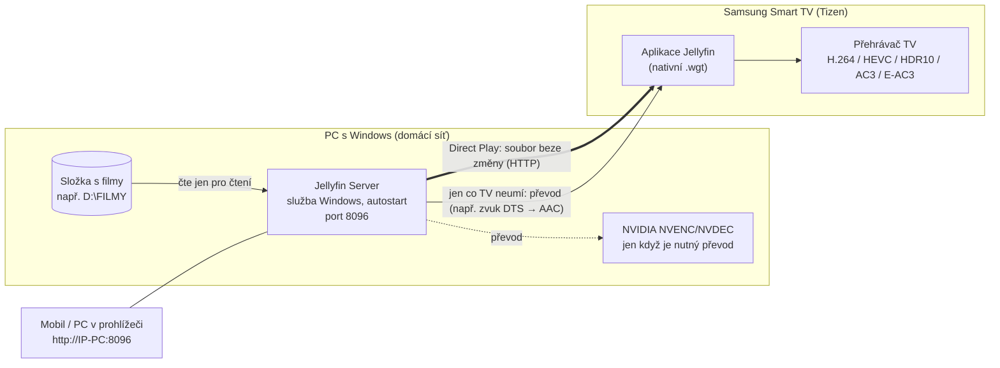
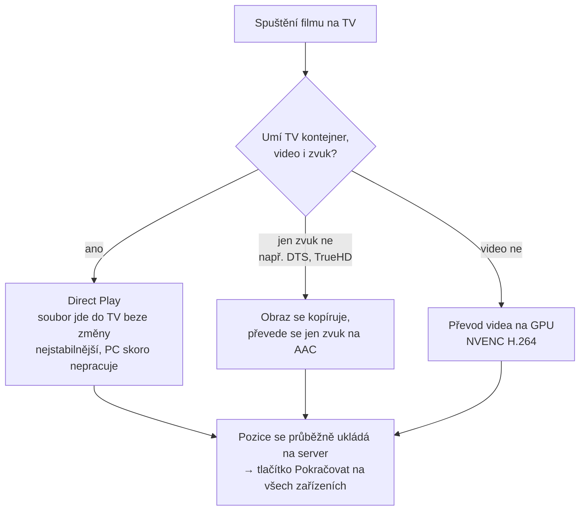
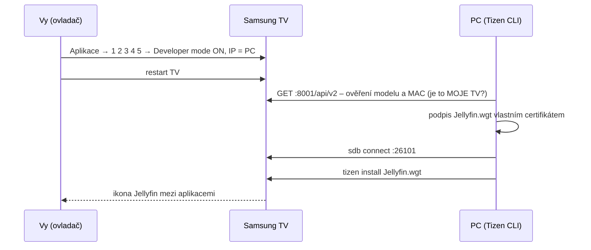

# Jellyfin: domácí filmy na Samsung Smart TV (Tizen)

Domácí filmotéka z PC s Windows do televize Samsung přes **oficiální Jellyfin Server** a **nativní aplikaci
Jellyfin na televizi**. Žádný vlastní server, žádné přehrávání v prohlížeči televize. Cílem je hlavně
**stabilní přehrávání** (Direct Play, přetáčení, pokračování od místa, kde jste skončili).

Řešení je ověřené na Samsungu **UE70RU7092** (2019, Tizen 5.0) a Jellyfinu **12.4**. Server běží na Windows 11
s grafikou NVIDIA RTX.

> Repozitář obsahuje jen princip, skripty a návod. Nejsou v něm filmy, hesla, certifikáty, instalačky ani adresy konkrétní sítě.

---

## Jak to funguje



**Co se kdy děje při spuštění filmu:**



**Jak se aplikace dostane do televize:**



### Proč sideload a ne obchod Samsung

Aplikace Jellyfin v obchodě Samsung Apps je jen pro televize **2021 a novější** (Tizen 6+). Starší modely
(2017–2020) ji v obchodě nenajdou. Stejnou oficiální aplikaci
([jellyfin/jellyfin-tizen](https://github.com/jellyfin/jellyfin-tizen)) ale jde nainstalovat z PC v režimu
vývojáře. Hotové sestavené balíčky jsou v
[jeppevinkel/jellyfin-tizen-builds](https://github.com/jeppevinkel/jellyfin-tizen-builds).

**Verze aplikace v TV musí odpovídat verzi serveru.** Při aktualizaci serveru proto nainstalujte i novou aplikaci
(postup je stejný, podepisuje se stejným certifikátem).

---

## Co je potřeba

| Co | Kde |
|---|---|
| PC s Windows 10/11 v domácí síti (ideálně kabelem, s pevnou IP nebo DHCP rezervací) | – |
| Jellyfin Server pro Windows | https://jellyfin.org/downloads/windows |
| Tizen Studio **CLI** (web-cli, bez IDE) od Samsungu | https://developer.tizen.org/development/tizen-studio/download |
| Jellyfin.wgt **stejné verze jako server** | https://github.com/jeppevinkel/jellyfin-tizen-builds/releases |
| Volitelně grafika NVIDIA (převod videa) | – |
| Python 3 (jen pro `tv_info.py`) | https://www.python.org |

---

## Instalace krok za krokem

### 1. Server na PC

1. Stáhněte instalačku Jellyfin Serveru pro Windows a ověřte její SHA256.
2. Ve **zvýšeném** PowerShellu spusťte:
   ```powershell
   .\scripts\1_install_server.ps1 -Installer C:\Downloads\jellyfin_12.4_windows-x64.exe
   ```
   Skript nainstaluje Jellyfin jako službu se **startem s Windows** a **restartem při pádu**. Ve firewallu otevře
   porty 8096/TCP a 7359/UDP, ale **jen pro soukromou síť a místní podsíť**.
3. Zkontrolujte, že síť PC má profil **Soukromá**:
   ```powershell
   Get-NetConnectionProfile
   ```

### 2. Knihovna filmů

1. Ještě **před** dokončením průvodce spusťte:
   ```powershell
   .\scripts\2_setup_library.ps1 -MediaPath 'D:\FILMY' -ServerName 'FILMY'
   ```
   Skript nastaví češtinu a vytvoří knihovnu **Filmy**. Je jen pro čtení: do složek s filmy se nic nezapisuje,
   metadata a náhledy jsou v `C:\ProgramData\Jellyfin\Server`.
2. Otevřete `http://localhost:8096` a projděte průvodce. Účet správce si založte sami a heslo si zapamatujte.
   **Proklikejte se až na poslední „Hotovo“** (viz [Řešení problémů](#řešení-problémů)).

### 3. Převod na grafické kartě (NVIDIA)

Nastavení kódování jde změnit jen po přihlášení, proto přes webové rozhraní:
**Ovládací panel → Přehrávání → Překódování**

- Hardwarová akcelerace: **Nvidia NVENC**
- Dekódování: zaškrtnout H.264, HEVC, MPEG2, VC1, VP8, VP9, AV1, HEVC 10bit a VP9 10bit
- Kódování: **H.264**. *HEVC a AV1 kódování vypnout*, protože H.264 je pro starší televize nejbezpečnější.
- Tone mapping: zapnout (HDR → SDR, když je potřeba)

Cílem ale je, aby převod skoro nikdy nebyl potřeba (Direct Play).

### 4. Aplikace do televize

1. Nainstalujte **Tizen Studio CLI**, například do `C:\tizen-studio`. Tichá instalace:
   ```powershell
   web-cli_Tizen_Studio_6.1_windows-64.exe --accept-license C:\tizen-studio
   ```
   Instalátor může po dokopírování souborů zůstat viset. Jakmile existuje `tools\sdb.exe`, je hotovo.
2. Stáhněte `Jellyfin.wgt` **stejné verze jako server**.
3. **Na televizi zapněte režim vývojáře:**
   1. Otevřete **Aplikace**.
   2. Na ovladači stiskněte **1 2 3 4 5**.
   3. Zvolte **Developer mode → On** a jako **Host PC IP** zadejte IP vašeho PC.
   4. Televizi **restartujte**, nejlépe na 10 s ze zásuvky.
4. Zjistěte, že na zvolené IP je opravdu vaše televize:
   ```powershell
   python scripts\tv_info.py 192.168.1.20
   ```
   Zapište si `modelName` a `wifiMac`.
5. Nainstalujte aplikaci:
   ```powershell
   .\scripts\3_install_tv.ps1 -TvIp 192.168.1.20 -ExpectedModel UE70RU7092UXXH -ExpectedMac aa:bb:cc:dd:ee:ff `
                              -Wgt C:\Downloads\Jellyfin.wgt -TizenRoot C:\tizen-studio
   ```
   Skript **nejdřív ověří model a MAC**, aby se aplikace nenainstalovala do sousedovy televize na stejné síti.
   Při prvním spuštění vytvoří podpisový certifikát a jeho heslo uloží mimo repozitář. Podepíše kopii balíčku,
   připojí se k TV, aplikaci nainstaluje a spustí.

### 5. První spuštění na TV

1. Aplikace Jellyfin server často nenajde sama. V takovém případě zvolte **Přidat server** a zadejte
   `IP-PC:8096`, například `192.168.1.10:8096`.
2. Přihlaste se. Pohodlnější je **Rychlé připojení**: televize ukáže kód a vy ho potvrdíte na PC nebo mobilu,
   kde jste přihlášení (ikona uživatele → Rychlé připojení). Heslo pak nemusíte psát ovladačem.

---

## Co televize 2019 (Tizen 5) umí přehrát přímo

| | Direct Play | Poznámka |
|---|---|---|
| MP4 / MKV, H.264 | ✅ | |
| MKV, HEVC (i 10bit), 4K, HDR10 | ✅ | |
| Dolby Vision | ⚠️ | TV ho neumí; profil 8 přehraje jako HDR10, profil 5 se převádí |
| AVI, MPEG-4 ASP (XviD/DivX) | ✅/⚠️ | starší ripy, většinou jdou |
| Zvuk AAC, AC3, E-AC3 (DD+) | ✅ | |
| Zvuk **DTS**, TrueHD | ❌ | server převede **jen zvuk** na AAC, obraz jde beze změny |

Jak se film opravdu přehrává, uvidíte v **Ovládacím panelu → Aktivita / Relace**: Direct Play, nebo Transcode
i s důvodem.

---

## Řešení problémů

| Příznak | Příčina / řešení |
|---|---|
| TV píše „nebyly nalezeny žádné servery“ | Automatické hledání (UDP 7359) na Tizenu často nefunguje. Zadejte server ručně: `IP-PC:8096`. |
| TV místo přihlášení ukazuje průvodce nastavením | Průvodce na serveru nebyl dokončený (`IsStartupWizardCompleted=false` v `system.xml`). Dokončete ho v prohlížeči až do „Hotovo“, nebo z PC: `Invoke-WebRequest http://localhost:8096/Startup/Complete -Method Post`. Průvodce na TV heslo existujícího účtu nezmění. |
| Zapomenuté heslo | Na přihlašovací stránce PC zvolte **Zapomenuté heslo** a zadejte uživatele. PIN se uloží do `C:\ProgramData\Jellyfin\Server\passwordreset*.json`. Po jeho zadání na stránce PIN je **heslo = ten PIN** (např. `AB-12-CD-34`). Přihlaste se s ním a v Profilu ho změňte. |
| `tv_info.py` hlásí `developerMode: 0` | Některé modely hlásí 0, i když je režim zapnutý. Rozhoduje, jestli projde `sdb connect IP:26101`. |
| `sdb connect` neprojde | Režim vývojáře je zapnutý s jinou IP, TV po zapnutí nebyla restartovaná, nebo PC a TV nejsou ve stejné síti. |
| Po aktualizaci serveru aplikace na TV hlásí chybu | Verze aplikace a serveru se liší. Stáhněte nový `.wgt` stejné verze a spusťte znovu krok 4.5. |
| Volání API vrací 401 | Od verze 12 nefunguje `?api_key=` v URL. Použijte hlavičku `Authorization: MediaBrowser Client="x", Device="x", DeviceId="x", Version="1", Token="…"`. |

---

## Bezpečnost

- Server je dostupný **jen z domácí sítě**: firewall pouští pouze profil Private a místní podsíť. Port do internetu
  se neotevírá.
- Do repozitáře nikdy nedávejte `*.p12`, hesla, `*.wgt`, instalačky ani filmy. Hlídá to `.gitignore`.
- Každý člen domácnosti by měl mít vlastní účet (Ovládací panel → Uživatelé), aby měl svou historii
  a „Pokračovat ve sledování“.
- Režim vývojáře na TV může zůstat zapnutý. Povoluje instalaci jen z jedné IP adresy, té vašeho PC.

## Licence a poděkování

Skripty v tomto repozitáři jsou volně k použití. Jellyfin je pod licencí GPL-2.0 a je projektem
[jellyfin.org](https://jellyfin.org). Balíčky pro Tizen sestavuje
[jeppevinkel/jellyfin-tizen-builds](https://github.com/jeppevinkel/jellyfin-tizen-builds).
